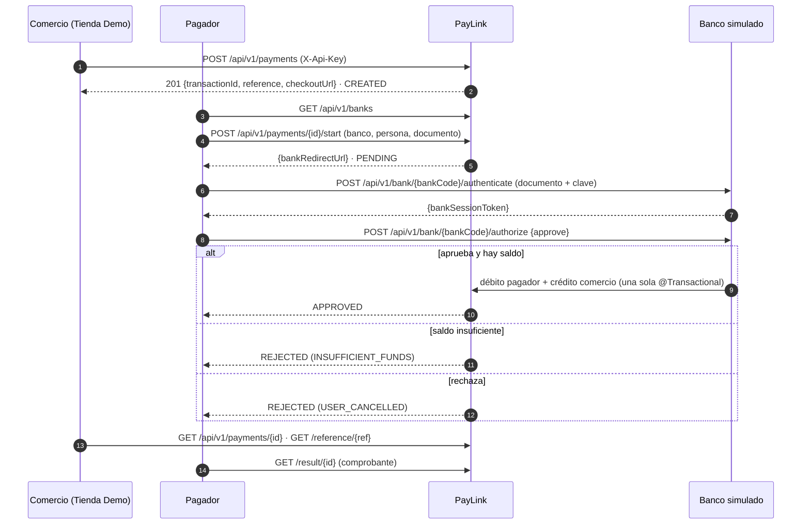

# PayLink — pasarela de pagos simulada

Mockup **educativo/demostrativo** de una pasarela de pagos por débito a cuenta bancaria (flujo tipo pago en línea con
redirección al banco). Monolito Spring Boot con H2 en memoria, API REST, pantallas web mínimas (Thymeleaf) y colección
Postman.

> Todos los nombres, documentos, cuentas y bancos son **ficticios**. No procesa dinero real ni se integra con ninguna
> entidad. No usar en producción: no tiene seguridad real (sin Spring Security, claves en texto plano, endpoints de saldo
> abiertos).

## Stack

- Java 21 (compila con `release 21`; probado también ejecutando sobre JDK 25)
- Spring Boot 3.5.7, Maven (incluye Maven Wrapper, no requiere Maven instalado)
- Spring Web, Spring Data JPA, Validation, Thymeleaf, H2 en memoria
- springdoc-openapi 2.8.9 (Swagger UI / OpenAPI 3.1)

## Cómo ejecutar

```bash
# Windows
mvnw.cmd spring-boot:run
# Linux / macOS
./mvnw spring-boot:run
```

- Aplicación: <http://localhost:8080> (tienda demo para crear una orden desde el navegador)
- Swagger UI: <http://localhost:8080/swagger-ui.html> — especificación en <http://localhost:8080/v3/api-docs>
  (copia exportada en `docs/openapi.json` y `docs/openapi.yaml`)
- Consola H2: <http://localhost:8080/h2-console> — JDBC URL `jdbc:h2:mem:paylink`, usuario `sa`, sin clave
- La base se recrea en cada arranque a partir de `src/main/resources/data.sql`.
- Datos y escenarios de prueba: [`docs/DATOS_DE_PRUEBA.md`](docs/DATOS_DE_PRUEBA.md)

Pruebas (unitarias de `PaymentService` + integración del camino feliz con MockMvc):

```bash
mvnw.cmd test        # o ./mvnw test
```

## Flujo



Estados: `CREATED → PENDING → APPROVED | REJECTED | FAILED | EXPIRED`.
Una transacción en `PENDING` por más de 15 minutos pasa a `EXPIRED` (motivo `PENDING_TIMEOUT`) al consultarla.

## Endpoints REST

| Método | Ruta | Descripción | Respuestas |
|---|---|---|---|
| POST | `/api/v1/payments` | Crea la orden. Header `X-Api-Key`. Body `{amount, description, returnUrl?}` | 201, 400, 401 |
| GET | `/api/v1/payments/{id}` | Estado y detalle por id | 200, 400, 404 |
| GET | `/api/v1/payments/reference/{reference}` | Estado y detalle por referencia | 200, 404 |
| POST | `/api/v1/payments/{id}/start` | Body `{bankCode, personType, documentType, documentNumber}` → `PENDING` | 200, 400, 404, 409 |
| GET | `/api/v1/banks` | Bancos disponibles | 200 |
| POST | `/api/v1/bank/{bankCode}/authenticate` | Body `{transactionId, documentType, documentNumber, password}` → `bankSessionToken` | 200, 400, 401, 404, 409 |
| POST | `/api/v1/bank/{bankCode}/authorize` | Body `{transactionId, bankSessionToken, approve}` → `APPROVED` / `REJECTED` | 200, 400, 401, 404, 409 |
| GET | `/api/v1/accounts/{number}/balance` | Saldo actual | 200, 404 |
| GET | `/api/v1/accounts/{number}/movements?transactionId=` | Movimientos (DEBIT/CREDIT), filtro opcional por transacción | 200, 404 |

Errores con formato uniforme:

```json
{ "timestamp": "2026-11-25T15:00:00", "status": 409, "error": "Conflict",
  "message": "No se puede autorizar la transacción PL-...: estado actual APPROVED, se esperaba PENDING",
  "path": "/api/v1/bank/ANDINO/authorize" }
```

Reglas: monto > 0 con máximo 2 decimales (`BigDecimal`); transiciones fuera del estado esperado → `409`; una
transacción aprobada no se reprocesa; el documento debe tener cuenta en el banco elegido (si no, `404`);
`returnUrl` solo acepta `http(s)`; el `bankSessionToken` es de un solo uso y vence en 10 minutos.

## Pantallas web

| Paso | Ruta |
|---|---|
| Tienda demo (crea una orden) | `/` |
| 1. Checkout: resumen + banco, tipo de persona y documento | `/checkout/{transactionId}` |
| 2. Login simulado del banco | `/bank/{bankCode}/login?tx=...` |
| 3. Aprobar / rechazar débito | `/bank/{bankCode}/authorize?tx=...` |
| 4. Comprobante | `/result/{transactionId}` |

Las pantallas usan los mismos servicios que la API REST.

## Datos de prueba (ficticios)

Bancos: `ANDINO` (Banco Andino), `CONDOR` (Banco Cóndor), `PACIFICO` (Banco Pacífico Digital).

Comercio: **Tienda Demo S.A.S.** — NIT `900000001` — API key `demo-api-key-123` — cuenta `9000000001` (Banco Andino, saldo inicial 1.000.000,00).

| Pagador | Banco | Documento | Cuenta | Saldo inicial | Clave | Uso sugerido |
|---|---|---|---|---|---|---|
| Ana Prueba Ficticia | ANDINO | CC `1000000001` | `1000000001` | 5.000.000,00 | `1234` | Camino feliz / rechazo |
| Luis Saldo Bajo | ANDINO | CC `1000000002` | `1000000002` | 10.000,00 | `1234` | Fondos insuficientes |
| Marta Ejemplo Cóndor | CONDOR | CE `2000000001` | `2000000001` | 2.000.000,00 | `1234` | Otro banco |
| Empresa Ficticia Ltda. | PACIFICO | NIT `800000001` | `3000000001` | 10.000.000,00 | `1234` | Persona jurídica |

## Colección Postman

Archivos en `postman/`:

- `PayLink.postman_collection.json` (v2.1) — 47 requests, 97 assertions.
- `PayLink.postman_environment.json` — `baseUrl`, `apiKey`, `payerAccount`, `merchantAccount`.

Carpetas: **1. Setup**, **2. Pago aprobado (camino feliz)**, **3. Pago rechazado por el usuario**,
**4. Fondos insuficientes**, **5. Errores de validación** (monto negativo, API key inválida, banco inexistente,
documento inexistente, transiciones inválidas 409, clave errada, etc.).

Cada request tiene `pm.test` y los scripts guardan automáticamente `transactionId`, `reference`, `bankSessionToken`,
saldos de referencia, etc. con `pm.collectionVariables.set` para encadenar el flujo.

Para ejecutarla:

1. Arranca la aplicación (`mvnw.cmd spring-boot:run`).
2. En Postman: *Import* → ambos archivos → selecciona el environment **PayLink Local**.
3. Clic derecho sobre la colección → *Run collection* → ejecutar en orden (sin cambiar el orden de las carpetas).

O desde consola con Newman:

```bash
npx newman run postman/PayLink.postman_collection.json -e postman/PayLink.postman_environment.json
```

> Las variables dinámicas (`transactionId`, `reference`, `bankCode`, `bankSessionToken`…) viven como variables de
> **colección**, no en el environment: en Postman el environment tiene prioridad y, si las incluyera vacías, taparía los
> valores que guardan los scripts. Las verificaciones de saldo son relativas a los saldos leídos en *Setup*, por lo que
> la colección también pasa si se vuelve a ejecutar sin reiniciar la aplicación.

## Estructura

```
src/main/java/com/quind/paylink
 ├─ controller/api   REST (pagos, bancos, cuentas)
 ├─ controller/web   Thymeleaf (tienda demo, checkout, portal bancario, comprobante)
 ├─ service          PaymentService, BankService, AccountService
 ├─ repository       Spring Data JPA
 ├─ model            Entidades JPA + enums
 ├─ dto              Records de request/response
 ├─ exception        ApiException, GlobalExceptionHandler (JSON), WebExceptionHandler (HTML)
 └─ config           Clock inyectable (para probar la expiración), OpenAPI
docs/
 ├─ DATOS_DE_PRUEBA.md   cuentas, credenciales, escenarios y casos de error
 └─ openapi.json|yaml    especificación OpenAPI exportada
```
